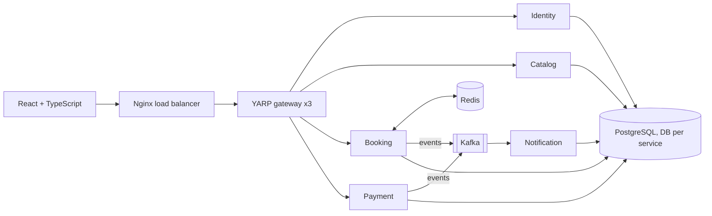

# TicketRush

A high-concurrency event ticketing platform built to explore production-grade system design: seat-locking under load, event-driven workflows, caching, and horizontal scaling. Everything runs locally with open-source tools and zero cloud cost.

> **Status:** Phase 0 (foundation). See the roadmap below.

## Target architecture



## Tech stack

| Area | Choice |
|---|---|
| Frontend | React, TypeScript, Vite, React Query |
| Backend | .NET 10 (LTS), ASP.NET Core, EF Core, MediatR, FluentValidation |
| Database | PostgreSQL |
| Cache / locks | Redis |
| Messaging | Apache Kafka (KRaft) |
| Load balancing | Nginx + YARP |
| Observability | Serilog + Seq, OpenTelemetry + Jaeger, Prometheus + Grafana |
| Testing | xUnit, Testcontainers, k6 |
| CI/CD | GitHub Actions |

## Roadmap

| Phase | Focus | Status |
|---|---|---|
| 0 | Foundation: repo, domain model, ADR | In progress |
| 1 | Modular monolith + React UI | Planned |
| 2 | Auth, Redis holds/locks, SignalR | Planned |
| 3 | Microservices, Kafka, outbox, saga | Planned |
| 4 | Gateway, load balancer, containers | Planned |
| 5 | Observability | Planned |
| 6 | Testing and load testing | Planned |
| 7 | CI/CD, docs, demo video | Planned |

## Getting started (Phases 1-2)

```bash
bash scripts/check-prereqs.sh                                  # verify toolchain
docker compose -f deploy/docker-compose.dev.yml up -d          # Postgres + Redis
```

Full-stack instructions will be added in Phase 4.

## Documentation

- [Domain model and state machine](docs/domain-model.md)
- [Architecture decisions](docs/adr/)
