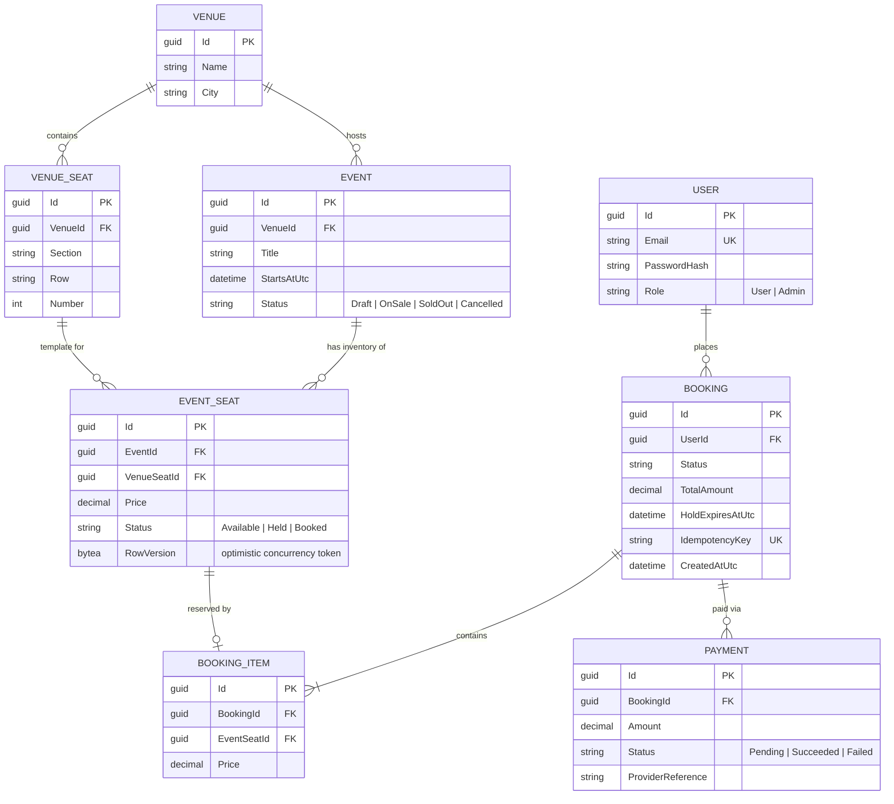
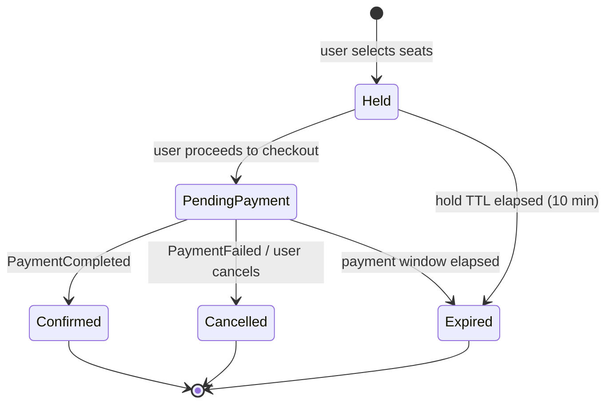

# TicketRush: Domain Model

> Design this *before* writing code. Every table, event, and Redis key in later phases comes from this page.

## 1. Core entities

**Why `VENUE_SEAT` and `EVENT_SEAT` are separate:** a venue's layout is reusable, but price and availability are per event. `EVENT_SEAT` is the row that gets contended under load and carries the `RowVersion`.

## 2. Booking state machine

| Transition | Seat effect | Event emitted (Phase 3) |
|---|---|---|
| → Held | EventSeat: Available → Held | `booking.created` |
| → Confirmed | EventSeat: Held → Booked | `booking.confirmed` |
| → Cancelled / Expired | EventSeat: Held → Available | `seat.released` |

## 3. Business invariants (these become tests)

1. A seat can belong to **at most one active booking**; never double-booked, even under concurrent requests.
2. A hold lasts **10 minutes**; an expired hold must release its seats automatically.
3. A booking has **1 to 6 seats**, all from the same event.
4. Only bookings in `Held` or `PendingPayment` can be paid, and only **once** (idempotent).
5. A `Confirmed` booking is immutable.
6. Total amount always equals the sum of its items' prices at the time of booking.
7. Events can only be booked while `OnSale` and before `StartsAtUtc`.

## 4. Key flows to implement

| # | Flow | Phase |
|---|---|---|
| F1 | Browse events and view the seat map | 1 |
| F2 | Hold seats (Redis lock + DB concurrency) | 1 → 2 |
| F3 | Checkout and pay (mock gateway) | 1 → 3 |
| F4 | Hold expiry / release | 2 |
| F5 | Payment failure → compensation | 3 |
| F6 | Live seat updates to other users | 2 |

## 5. Future service boundaries (Phase 3 split)

Design the monolith as modules that map onto these, so the split is mostly moving folders:

| Service | Owns | Talks to others via |
|---|---|---|
| Identity | User, roles, tokens | JWT validated at the gateway |
| Catalog | Venue, VenueSeat, Event | `event.*` events; REST for reads |
| Booking | Booking, BookingItem, EventSeat status | Kafka (`booking.*`, `seat.*`) |
| Payment | Payment | Kafka (`payment.*`) |
| Notification | Message log | Kafka consumer only |

> **Open question to resolve in Phase 3:** `EventSeat` is used by Catalog (seat map) and Booking (status). The cleanest answer is that Booking owns seat *status* and Catalog owns seat *definition*. Capture the decision as an ADR when you get there.

## 6. Redis keys (preview for Phase 2)

| Key | Purpose | TTL |
|---|---|---|
| `event:{id}:details` | cached event details | 5 min |
| `events:list:{page}` | cached listing | 1 min |
| `hold:{eventId}:{seatId}` | seat hold owner (user id) | 10 min |
| `lock:seat:{seatId}` | short distributed lock | 5 s |
| `blacklist:jti:{id}` | revoked JWT | token lifetime |
